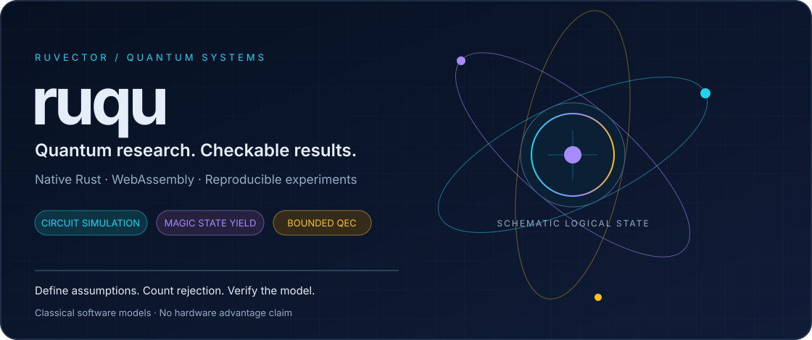
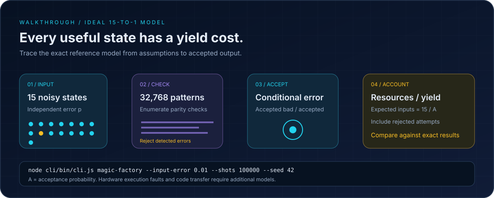
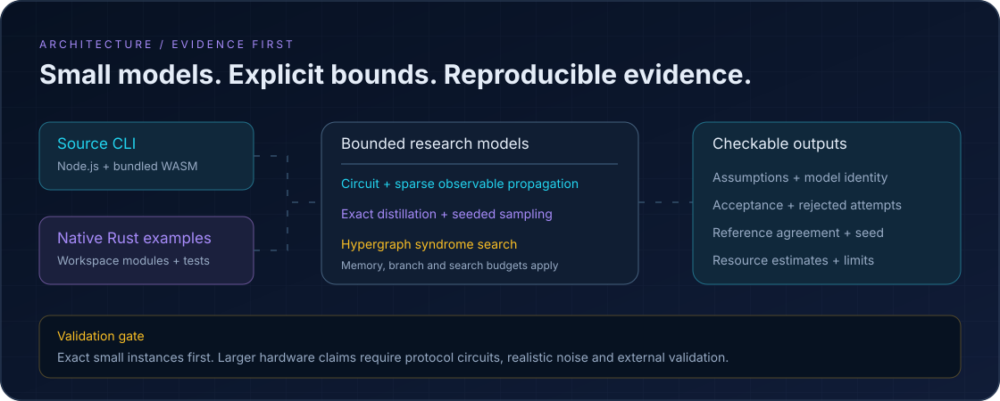

# ruqu: Rust Quantum Circuit Simulator, Magic State Cultivation and Quantum Error Correction

[](#quick-start)

[](https://www.rust-lang.org)
[](#webassembly)
[](#license)

**ruqu is a Rust quantum computing toolkit for circuit simulation, magic state cultivation, resource estimation, quantum error correction research and WebAssembly experiments.** Explore noisy quantum circuits, compare distillation yield against output error, and build reproducible software controls with explicit model assumptions.

[Open the animated Quantum Explorer](https://ruvnet.github.io/ruqu/explorer/) · [Quick start](#quick-start) · [Magic state walkthrough](#magic-state-factory-walkthrough) · [Research and limits](#recent-quantum-research) · [Crates](#rust-crates) · [Observer laboratory](#observer-consistency-laboratory)

## What you can build

| Task | Available path | Scope |
| :--- | :--- | :--- |
| Quantum circuit simulation | `ruqu-core`, `ruqu-wasm`, CLI | State vectors, gates and noise models; memory grows exponentially with qubits. |
| Quantum optimization and search | `ruqu-algorithms` | VQE, QAOA and Grover experiments. |
| Magic state factory analysis | `magic-factory`, native example | Ideal 15-to-1 error-pattern enumeration, seeded sampling and resource estimates. |
| Surface-code cultivation | Shared research API and browser Explorer | Dense 16-qubit realization of the published f=3 cultivation stage; escape and final decoder excluded. |
| Structured observable simulation | Shared research API and native example | Supported Clifford gates, T branching and Pauli noise; branch budgets bound growth. |
| Correlated syndrome experiments | Native hypergraph decoder example | Bounded small-instance search; explicit resource limits. |
| Research evidence memory | `research-memory` CLI | Official RVF WASM binary packaging, integrity validation and advisory retrieval; imported records cannot authorize promotion. |
| Reproducible quantum controls | `observer-lab` | Bundled WASM experiments with seed and evidence ledger. |
| Quantum and classical research | `ruqu-exotic`, coherence engine | Experimental algorithms; evaluate each model on its own evidence. |

The research numerical engine is shared across native Rust, Node.js and browser WebAssembly. These are classical software models, available in the source checkout and published npm packages. The cultivation stage is an explicit realization of a published small circuit, with documented syndrome-gadget ordering choices. It does not reproduce Google's full cultivation experiment, implement a hardware control service, or establish quantum advantage.

## Quick start

```bash
git clone https://github.com/ruvnet/ruqu.git
cd ruqu

# Run a source-checkout quantum simulation.
node cli/bin/cli.js simulate --qubits 4

# Estimate magic state yield with an exact reference and seeded sampling.
node cli/bin/cli.js magic-factory --input-error 0.01 --shots 100000 --seed 42

# Run native Rust research examples.
cargo run -p ruqu-core --example magic_states
cargo run -p ruqu-core --example hypergraph_decoder
cargo run -p ruqu-core --example pauli_propagation
```

Rust and Cargo are required for native examples; Node.js is required for the CLI. Existing simulator commands use the bundled Node WebAssembly binary. Install the published CLI with `npx @ruvector/ruqu@0.3.0 magic-factory --input-error 0.01 --shots 1000 --seed 42`. Browser bindings are available as [`@ruvector/ruqu-wasm@2.1.0`](https://www.npmjs.com/package/@ruvector/ruqu-wasm/v/2.1.0).

## Interactive quantum computing Explorer

**[Launch ruqu Quantum Explorer](https://ruvnet.github.io/ruqu/explorer/)** to compose quantum circuits, visualize state probabilities, compare magic factory yield and run bounded surface cultivation experiments. The animated interface includes circuit, factory, cultivation and evidence views, with mobile navigation, fullscreen controls and a motion toggle.

Numerical work executes Rust WebAssembly in a dedicated browser worker. The browser exports the latest request and result as JSON; RVF packaging is a separate CLI operation. No remote QPU or account is required.

## One research API across Rust, Node.js and browsers

`ruqu_core::research_api::run_json` and the WASM export `research_run_json` execute the same numerical implementations. Supported operations include `magic-factory`, `magic-exact`, `magic-sample`, `magic-resources`, `cultivation`, `pauli-evaluate` and `hypergraph-decode`. Seeds and large bit masks use decimal strings to avoid JavaScript integer precision loss. Invalid fields and oversized requests are rejected.

```bash
# The Node adapter calls the bundled Rust WASM implementation.
node cli/bin/cli.js research --json '{"op":"magic-exact","input_error":0.01}'

# The same request runs natively through stdin.
printf '%s' '{"op":"magic-exact","input_error":0.01}' | cargo run -p ruqu-core --example research_api

# The bounded cultivation stage uses physical gate, preparation and readout faults.
node cli/bin/cli.js research --json '{"op":"cultivation","attempts":8,"seed":"42","gate_error":0.001,"preparation_error":0.001,"measurement_error":0.001}'
```

```js
import init, { research_run_json } from "./explorer/wasm/ruqu_wasm.js";
await init();
const result = JSON.parse(research_run_json(JSON.stringify({
  op: "magic-exact", input_error: 0.01
})));
```

## Published f=3 cultivation stage

The `cultivation` operation simulates 13 data qubits and 3 cat ancillas using dense state-vector trajectories. It realizes the injection, conversion, syndrome verification and two logical-check rounds from [arXiv:2609.16929v1](https://arxiv.org/abs/2609.16929). It excludes escape, final decoding and consumption in a logical gate. It implements this small circuit, rather than the paper's polynomial Clifford-stabilizer simulation algorithm.

The [protocol transcription](docs/research/cultivation-protocol.md) records the syndrome-gadget ordering choice and noise assumptions. Full-state infidelity includes correctable physical faults and cannot be equated with a decoded logical error curve.

```bash
cargo run -p ruqu-core --release --example cultivation
cargo run -p ruqu-core --release --example cultivation -- --audit
python scripts/verify-cultivation.py
```

The exhaustive single-fault audit covers **253 physical locations and 2,485 mechanisms**. It found zero accepted joint codespace/logical-HXY-minus events above its numerical threshold. This is a first-order check with ideal final error detection, **not a proof of fault distance three**. A separate NumPy calculation checks 29 ideal and selected-fault cases, with maximum absolute disagreement about `5.2 × 10^-15`; it does not independently enumerate every fault. [Independent evidence](docs/research/cultivation-independent-evidence.json).

## RVF research evidence

The CLI packages validated evidence records using the official `@ruvector/rvf-wasm` binary, with a required SHA-256-bound JSON sidecar. Exact identities include the circuit, noise model, seed, backend, environment and budget. Retrieval can suggest candidates while preserving the current backend.

```bash
# measured-evidence.json must follow the documented evidence schema.
node cli/bin/cli.js research-memory export --input measured-evidence.json --output memory.rvf
node cli/bin/cli.js research-memory import --input memory.rvf
node cli/bin/cli.js research-memory query --input memory.rvf --target target.json
```

Hashes establish integrity, not authenticity. Imported evidence has `trustedForPromotion: false`; backend promotion requires locally validated paired native holdouts. See the [evidence schema and trust contract](docs/research/research-memory.md).

## Magic state factory walkthrough



1. **Choose the noise assumption.** Supply an independent input error probability. The reference model assumes ideal distillation operations; input error is not a physical two-qubit gate error rate.
2. **Evaluate accepted and rejected patterns.** An integer dynamic program sums all `2^15 = 32,768` input patterns for the ideal 15-to-1 protocol; exhaustive enumeration independently verifies the spectrum. Seeded sampling provides a statistical comparison.
3. **Account for yield.** Divide per-attempt resources by acceptance probability. Include failed attempts in expected input consumption and qubit-cycle estimates.
4. **Check the model boundary.** Hardware leakage, coherent drift, correlated input errors, noisy Clifford operations and code transfer need separate models and validation.

```bash
# Reproducible sampling against the exact small reference model.
node cli/bin/cli.js magic-factory --input-error 0.01 --shots 100000 --seed 42

# Include two distillation stages and a fallible code transfer.
node cli/bin/cli.js magic-factory --input-error 0.01 --rounds 2 --transfer-acceptance 0.9 --transfer-error 0.000001 --transfer-qubits 20 --transfer-rounds 5

# Inspect cited research profiles with missing costs left unknown.
node cli/bin/cli.js magic-factory --research

# Run the bounded benchmark from the same checkout.
node cli/bin/cli.js magic-factory --benchmark
```

At low input error `p`, the ideal 15-to-1 output error begins at `35 p^3`; that asymptotic term does not include hardware execution faults. At `p = 0.01`, the exact ideal model gives approximately `86%` acceptance and `4 × 10^-5` conditional output error. Sampling `100,000` attempts usually observes only a handful of accepted errors at this rate, so the exact result is the useful accuracy reference.

## Architecture and evidence



Sparse Heisenberg Pauli propagation supports selected Clifford transformations, T/T-dagger branching, stochastic Pauli faults and postselection. It uses an explicit term budget; non-Clifford branching can still grow exponentially. This standard observable method is independent of the full recent logical magic state simulation algorithms.

CLI, browser and native Rust experiments share the same Rust research API and a scientific contract: state assumptions, preserve rejected attempts, bound computation, and compare results against a checkable reference. The hypergraph decoder is an independent small-instance baseline inspired by search-based QEC research. It is not the upstream Tesseract implementation or a demonstrated replacement for a production surface-code decoder.

## Recent quantum research

Reviewed on **16 October 2026**. [Implementation acceptance and measurements](docs/validation/quantum-research-2026-10-16.md). [Research notes and primary sources](docs/research/2026-10-16-quantum-advances.md) explain implementation status and validation gates. [ADR-003](docs/adr/ADR-003-magic-state-research.md) records the initial scope; [ADR-004](docs/adr/ADR-004-shared-research-api-cultivation-evidence.md) records shared execution, cultivation and evidence trust.

| Primary research | Relevance to ruqu | Status here |
| :--- | :--- | :--- |
| [Superconducting magic state cultivation](https://arxiv.org/abs/2512.13908) | Yield and transfer-aware resource accounting | Experimental reference; no Willow hardware reproduction. |
| [Efficient logical magic state simulation, PRX Quantum 2026](https://arxiv.org/abs/2512.23799) | Specialized exact algorithms under Pauli noise | Research direction; full algorithm not implemented. |
| [Clifford-stabilizer simulation, September 2026](https://arxiv.org/abs/2609.16929) | Avoid generic state-vector cost for supported protocols | Dense f=3 stage realization; full Clifford-stabilizer algorithm and distance-7 result not reproduced. |
| [Unfolded distillation for biased noise](https://www.nature.com/articles/s41534-026-01197-z) | Make hardware noise bias explicit in comparisons | Research reference; no device-specific advantage claim. |
| [Tesseract decoder](https://arxiv.org/abs/2503.10988) and [2026 search acceleration](https://arxiv.org/abs/2609.10056) | Correlated detector faults and search budgets | Independent bounded decoder baseline; full algorithms not ported. |

## Rust crates

| Crate | Purpose |
| :--- | :--- |
| [`ruqu-core`](crates/ruqu-core) | Circuit simulation, stabilizer and other backend modules, noise models, magic state analysis and bounded decoding research. |
| [`ruqu-algorithms`](crates/ruqu-algorithms) | VQE, Grover, QAOA and surface-code experiments. |
| [`ruqu-exotic`](crates/ruqu-exotic) | Experimental quantum and classical hybrid algorithms. |
| [`ruqu-wasm`](crates/ruqu-wasm) | Browser and JavaScript WebAssembly bindings. |
| [`ruqu`](crates/ruQu) | Classical coherence assessment using dynamic min-cut. |

For reproducible development use workspace path dependencies:

```toml
[dependencies]
ruqu-core = { path = "crates/ruqu-core" }
ruqu-algorithms = { path = "crates/ruqu-algorithms" }
```

```rust
use ruqu_algorithms::qaoa::{run_qaoa, Graph, QaoaConfig};

let graph = Graph::from_edges(4, &[(0, 1), (1, 2), (2, 3), (3, 0)]);
let result = run_qaoa(&graph, &QaoaConfig::default());
println!("best cut = {:?}", result.best_bitstring);
```

## WebAssembly

```bash
wasm-pack build crates/ruqu-wasm --target web
```

```js
import init from "./pkg/ruqu_wasm.js";
await init();
```

A state vector of 25 qubits needs about `512 MiB` for amplitudes alone at complex float64 precision; temporary buffers and runtime overhead increase memory use. Actual limits depend on the browser and backend. The shared research API exports bounded factory, cultivation, sparse Pauli and hypergraph operations through WASM; native-only example and audit commands remain separate.

## Build and verify

```bash
cargo build --release
cargo test -p ruqu-core
cargo test -p ruqu-core --release --test cultivation
node --test cli/tests/*.test.cjs
node scripts/verify-research.cjs
```

The CLI also supports `grover`, `qaoa`, `capabilities` and `doctor`; see the [CLI guide](cli/README.md). Acceptance requires agreement with exact references, reproducible seeded results and explicit failure when a computational bound is exceeded. Benchmark wall times depend on host, build profile and workload.

## Observer consistency laboratory

Run reproducible two-qubit controls, reversible observer interactions, and separately
labelled classical memory interventions using the bundled WASM engine:

```bash
node cli/bin/cli.js observer-lab --count 128 --seed 20260920
node cli/bin/cli.js observer-lab --benchmark
node --test cli/tests/observer-lab.test.cjs
```

The optional [native integration](integrations/observer-world/README.md) validates
the evidence before projecting it into **actual ruField synthetic events and an
actual WorldGraph belief graph**, using pinned upstream Rust crates. It requires
an independently supplied trusted ledger root and rejects physical sensor claims.
No existing database, sensor or cloud service is changed.

These are software controls of established quantum predictions, **not a QPU run,
new physics, physical Bell test, or quantum advantage**. See the
[architecture](docs/adr/ADR-002-observer-world-laboratory.md) and
[validation evidence](docs/observer-world-validation.md). The CLI commands are available from this checkout and [`@ruvector/ruqu@0.3.0`](https://www.npmjs.com/package/@ruvector/ruqu/v/0.3.0).

## Visual assets

The introduction, walkthrough and architecture are native SVG with embedded animation, readable static frames, accessible titles and reduced-motion CSS. No scripts, external fonts or tracking are embedded. Renderers that disable animation still show the complete diagrams.

## License

MIT © Ruvector Team. Part of the [RuVector](https://github.com/ruvnet/ruvector) ecosystem (extracted per ADR-257). Research references retain their original authorship and licenses.

### AWS and Google quantum integration

Export circuits from the [Explorer](https://ruvnet.github.io/ruqu/explorer/) to the [cloud quantum bridge](integrations/quantum-cloud/README.md). Run both provider SDK simulators locally, or explicitly submit through AWS Braket and approved Google Quantum Engine projects. Credentials remain on the host; Google hardware access is restricted. Local SDK compatibility is tested; live hardware access is not claimed.
